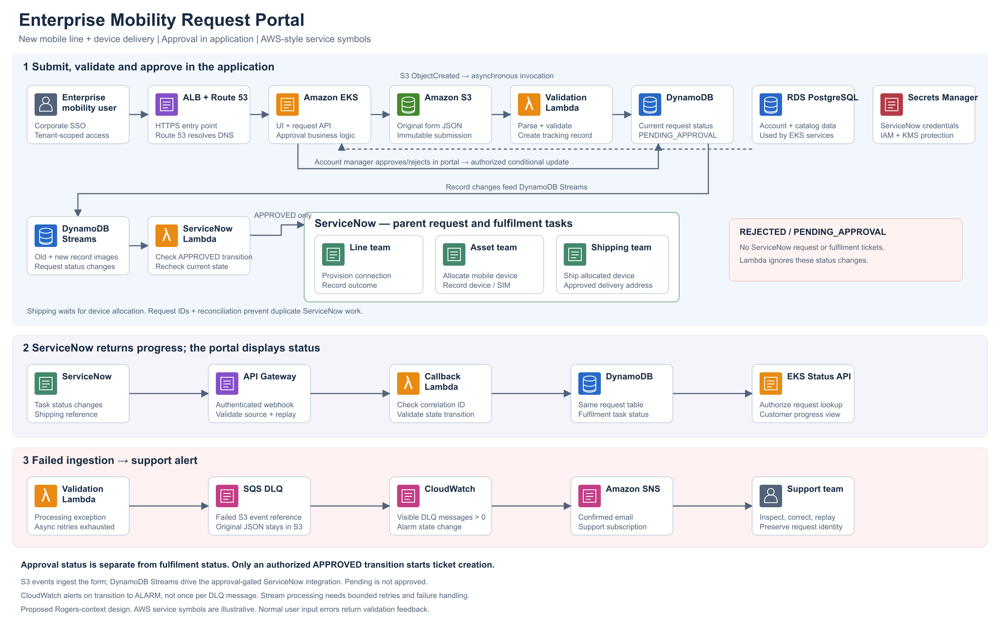

# Enterprise Mobility Request Portal

A telecom project design for enterprise mobility administrators to request new connections, close lines and replace damaged devices. The reference journey is **a new mobile line with a device delivered to an approved address**.

The portal combines **EKS microservices**, **event-driven AWS processing** and **ServiceNow fulfilment**. Account managers approve or reject requests inside the application. Only an authorized transition to `APPROVED` starts ServiceNow ticket creation.

> **Project scope:** This is a proposed  business architecture supported by hands-on AWS labs. It is not an official Rogers system or evidence of access to Rogers production. The retained sample application demonstrates microservice operations; it does not implement the telecom business logic. The EKS lab was previously deployed and subsequently destroyed by the owner. Screenshots are historical evidence, not a current availability claim.

## Architecture



[Editable diagram](docs/architecture/enterprise-mobility-request-portal.svg) · [Architecture and request lifecycle](docs/ARCHITECTURE.md)

```text
Enterprise user -> HTTPS ALB -> EKS request service -> S3 request JSON
                                                       |
                                                Validation Lambda
                                                       |
                                         DynamoDB: PENDING_APPROVAL
                                                       ^
Account manager -> application approval business logic -+
                                                       |
                                         DynamoDB Streams
                                                       |
                                   Integration Lambda: APPROVED only
                                                       |
                                   ServiceNow parent + fulfilment tasks
                                      line / device assets / shipping

ServiceNow -> authenticated API Gateway -> callback Lambda -> DynamoDB
Portal Status API reads DynamoDB to display fulfilment progress.

Failed asynchronous ingestion -> SQS DLQ -> CloudWatch alarm -> SNS -> support
```

## Business objectives

- Give enterprise mobility teams a consistent, traceable request journey.
- Validate account, product and delivery information before approval.
- Enforce account-manager authorization before downstream fulfilment.
- Coordinate line provisioning, device allocation and shipping under a parent request.
- Display fulfilment progress without requiring customers to access internal tickets.
- Retain failed backend work for investigation and controlled reprocessing.

Success measures would include request completion time, approval age, fulfilment backlog, duplicate-task rate and processing failures. No measured business improvement is claimed.

## Documentation

| Topic | Guide |
|---|---|
| Business journey, microservices, AWS services and ServiceNow callbacks | [Architecture](docs/ARCHITECTURE.md) |
| Git branching, GitHub workflows and Terraform deployment | [Terraform delivery](docs/TERRAFORM-DELIVERY.md) |
| Dev, test, staging and production configuration | [Environments](docs/ENVIRONMENTS.md) |
| Infrastructure release calendar, approval and recovery | [Release strategy](docs/RELEASE.md) |
| Individual responsibilities and collaboration | [Teams](docs/TEAMS.md) |
| Implemented evidence versus proposed work | [Deliverables](docs/DELIVERABLES.MD) |
| Existing EKS screenshots and operations experiments | [Historical lab evidence](docs/LAB-EVIDENCE.md) |
| Short presentation narrative | [Presentation notes](docs/PRESENTATION.md) |

The delivery documentation covers **Terraform infrastructure as code only**. Application-image build/promotion experiments remain in the repository but are outside this presentation's delivery narrative.

## Terraform infrastructure delivery

```text
Short-lived branch -> PR -> validation + TFLint -> reviewed merge to main
    -> manually start dev workflow -> generate and save dev plan
    -> review plan -> dev-apply approval -> verify checksum -> apply same plan
```

Configured workflows:

- [Terraform PR Checks](.github/workflows/terraform-pr-checks.yml): validates all four environment directories and runs TFLint. Formatting and Checkov currently run as advisory checks.
- [Terraform Environment Plan](.github/workflows/Terraform-plan.yaml): manually plans a selected environment; does not apply it.
- [Terraform Dev Deployment](.github/workflows/terraform-dev-deploy.yml): manually generates a saved dev plan, stores it in S3 and applies it through the separate `dev-apply` job when enabled and changes exist. Required reviewers must be configured in GitHub environment settings.

**Current versus target:** A dev saved-plan workflow is implemented. Test/staging/production apply pipelines and automatic infrastructure promotion are not implemented. The target promotes reviewed code versions, with a new plan and release decision for each environment; it never reuses dev's plan or state in production.

## Repository layout

```text
Infra/
  environments/{dev,test,staging,production}/
  modules/{vpc,rds}/
.github/workflows/                    # Existing workflows; see delivery inventory
docs/architecture/                    # Presentation diagram PNG + editable SVG
docs/                                 # Architecture, delivery and evidence
retail-store-sample-app/               # Retained microservice demonstration source
```

The infrastructure retains its existing resource names and backend keys. The project title does not rename Terraform-managed resources or migrate state. The GitHub repository URL remains `mreddi8997/EKS-application`; changing its slug requires checking OIDC trust and existing references.

## Implementation boundary

| Area | Status |
|---|---|
| VPC, private EKS API, managed nodes, IAM access and RDS | Terraform configuration present; historical dev deployment evidence |
| S3 remote Terraform state and native locking | Configured with separate environment state keys |
| Saved-plan dev infrastructure deployment | Implemented GitHub Actions workflow and historical successful run |
| S3 -> Lambda -> DynamoDB ingestion, lookup API, DLQ alerting | Demonstrated separately in the [serverless companion repository](https://github.com/mreddi8997/Serverless-Event-Driven-Data-Pipeline-on-AWS) for software-licence requests |
| New-line validation, in-application approval and tenant authorization | Proposed telecom application implementation |
| Approval-filtered DynamoDB Streams -> ServiceNow integration | Proposed integration; not implemented by existing retail code |
| ServiceNow callbacks and end-to-end telecom fulfilment | Proposed integration |
| Route 53, HTTPS, SSO and production readiness in the diagram | Target architecture; not all provisioned by this repository |

Do not run a Terraform apply simply to view this project. Deployment requires the intended AWS account, existing backend, OIDC roles, permissions and an explicit review of the plan; it creates chargeable resources.
