# Project Deliverables

## 1. Terraform Infrastructure and Dev Deployment

Repository: https://github.com/mreddi8997/EKS-application

Terraform configuration is organized into dev, test, staging, and
production environment directories, with shared VPC and RDS modules.
The EKS configuration uses the upstream Terraform EKS module.

The dev environment was deployed in AWS us-east-2 using GitHub Actions.
The workflow generates a saved Terraform plan, stores it in S3,
requires approval through the dev-apply environment, and applies
the saved plan.

### Terraform structure

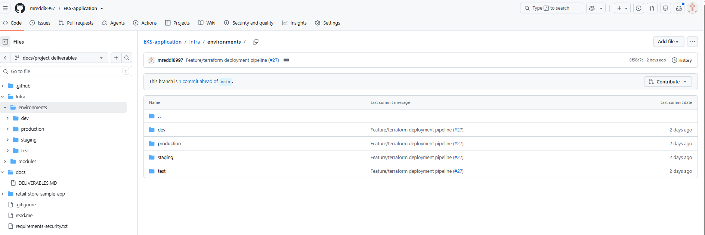

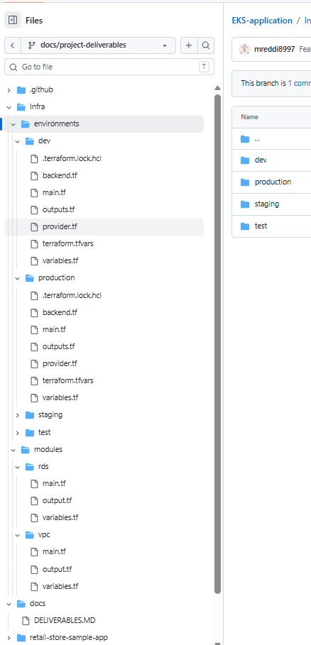

### Successful deployment pipeline

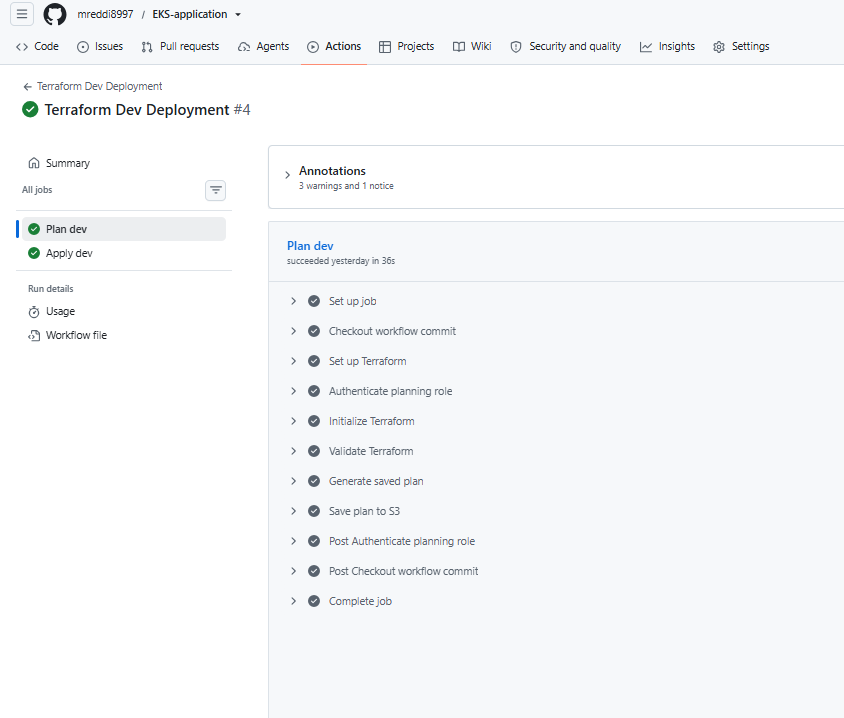

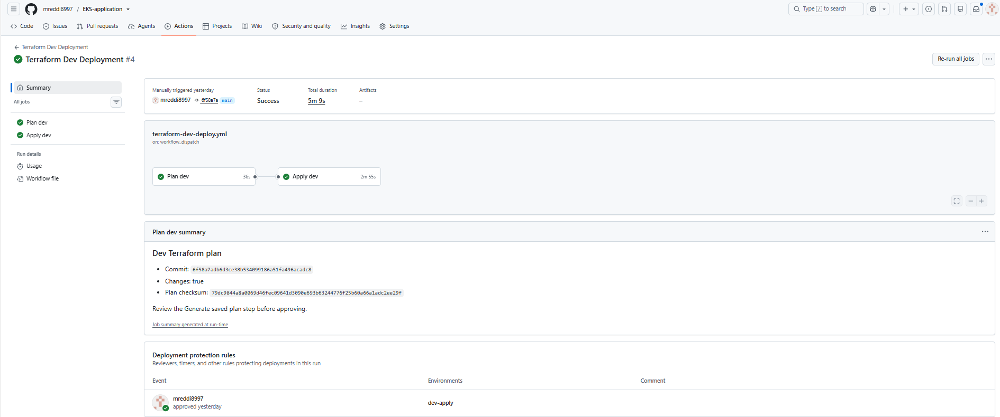

### Running EKS cluster

The eks-application-dev cluster is Active and runs Kubernetes 1.35.
At the time of capture, the console reported nine nodes and one
node group.

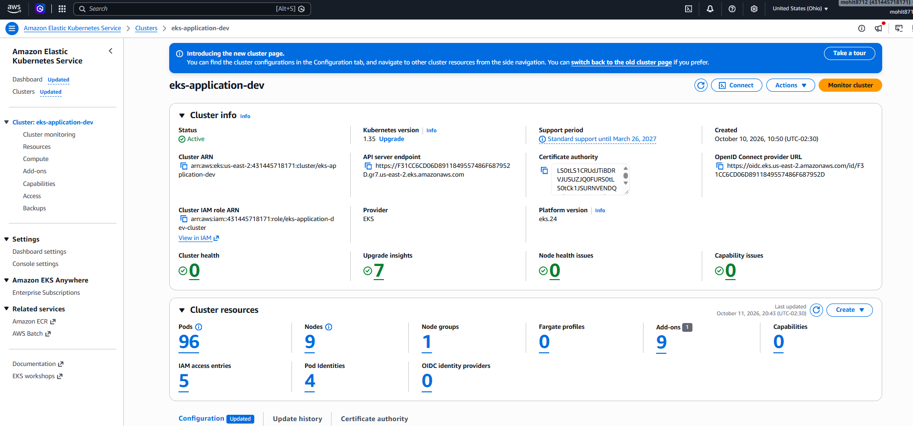

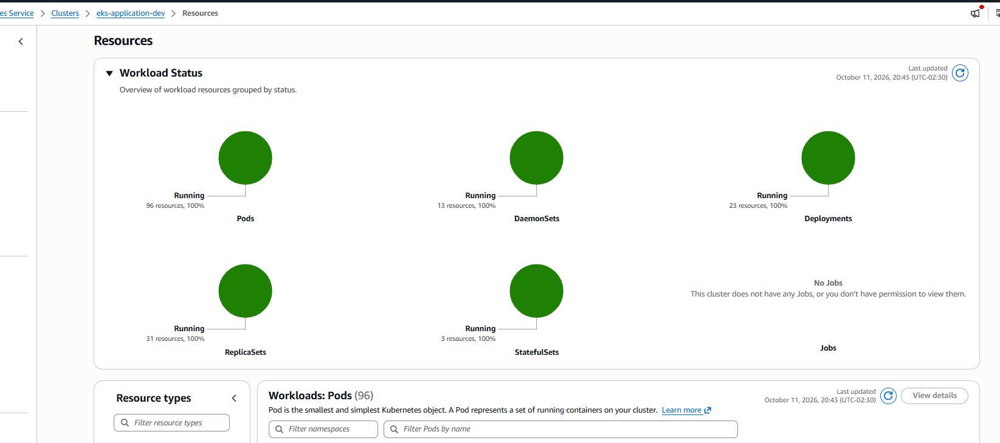

### Remote Terraform state

Dev Terraform state is stored at:

s3://terraform-backend-mohit/terraform-backend-mohit/dev/terraform.tfstate

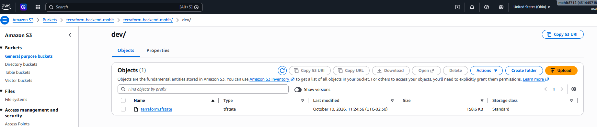

### Remaining evidence

- Managed node group status and scaling configuration.
- Terraform apply resource summary.
- Verification of the Terraform-managed ECR repository requirement.

Only the dev deployment is evidenced here. The presence of other
environment directories does not demonstrate deployment to those environments.

### Managed node group

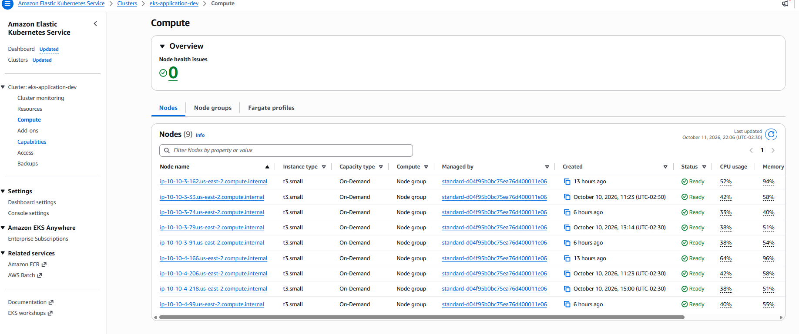

### Terraform apply result

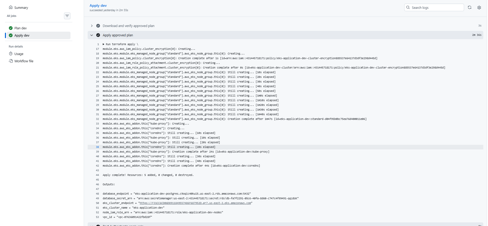

## 2. Microservice Deployment with Argo CD and Helm

Five retail microservices were deployed as separate Argo CD Applications.
Each Application uses its service-specific Helm chart from the GitHub
repository and deploys into a dedicated namespace.

| Service | Namespace | Helm chart path |
|---|---|---|
| UI | ui | retail-store-sample-app/src/ui/chart |
| Catalog | catalog-dev | retail-store-sample-app/src/catalog/chart |
| Cart | cart-dev | retail-store-sample-app/src/cart/chart |
| Checkout | checkout-dev | retail-store-sample-app/src/checkout/chart |
| Orders | orders-dev | retail-store-sample-app/src/orders/chart |

Argo CD tracks the main branch. Helm values configure service names,
in-memory storage, and cross-namespace service endpoints.

The application charts contain Kubernetes templates for Deployments,
Services, service accounts, ConfigMaps, and HPAs. The UI chart also
contains an Ingress template.

The UI is exposed through an internet-facing ALB managed by the
AWS Load Balancer Controller. Backend Services remain internal.

### Argo CD Applications

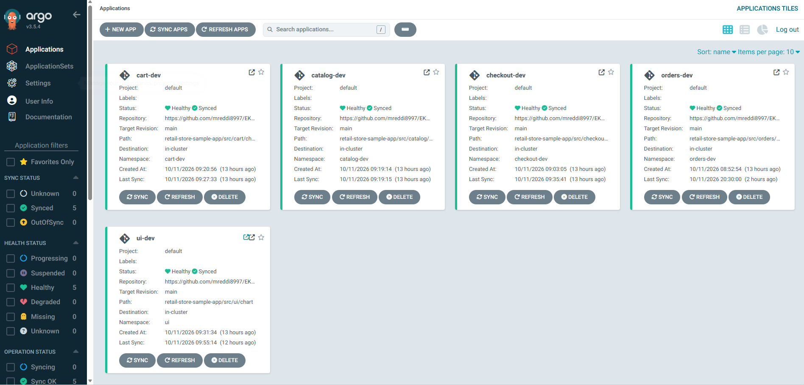

### Application source and destination

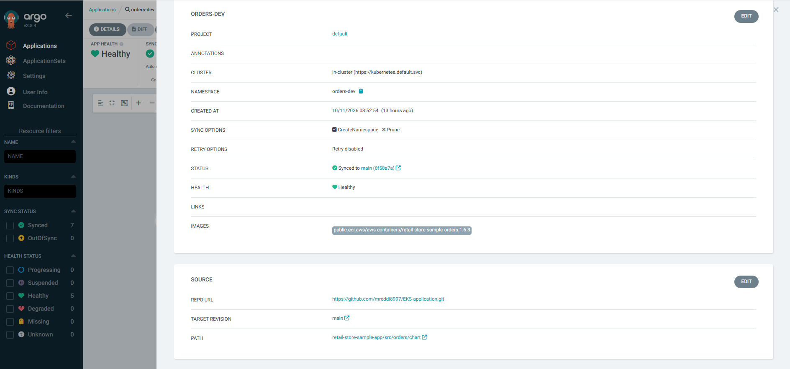

### Running microservice pods

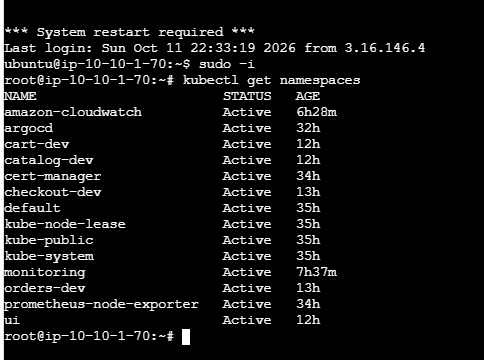

### Retail application

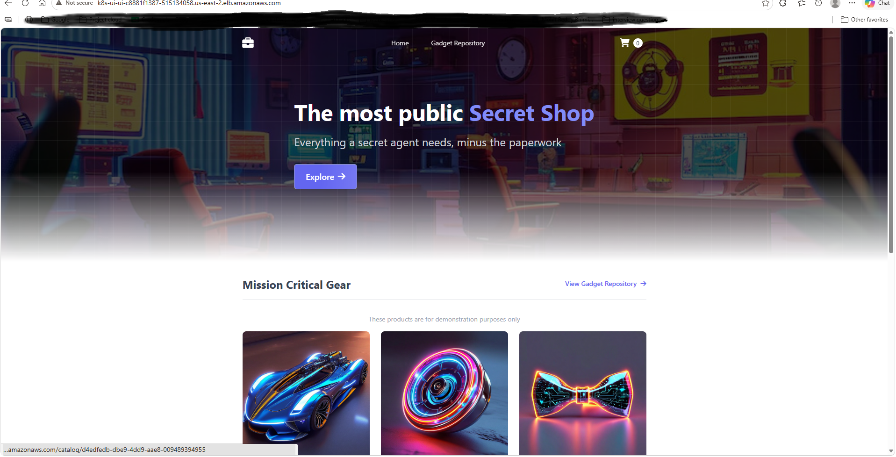

### Implementation notes

- This implementation uses Helm chart templates rather than a separate k8s/ folder.
- Application configuration was initially entered through Argo CD's UI.
  Environment values and Application definitions should also be committed
  to Git for reproducibility.
- Application persistence currently uses in-memory storage.
- The UI ALB currently serves HTTP; HTTPS remains a future improvement.

## 3. Horizontal Pod Autoscaling

A bounded HTTP load test was run against the UI Service using Fortio.
The UI HPA was configured with a minimum of 1 replicas, a maximum
of 10 replicas, and a CPU utilization target of 50%.

The terminal screenshot records the observed HPA metrics and replica
counts. Argo CD shows the corresponding UI workload and pods.

### HPA scaling evidence

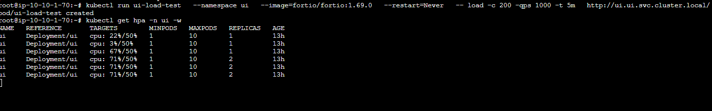

### Scaled UI workload

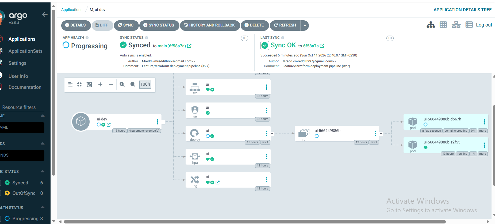

## 4. Observability

Prometheus and Grafana were installed using the kube-prometheus-stack
Helm chart in the monitoring namespace.

Grafana uses a persistent gp3 EBS volume. Prometheus also has persistent
storage configured.

The existing EKS node-exporter DaemonSet is scraped through a
ServiceMonitor. Pod resource usage and Kubernetes workload state are
collected through the stack's kubelet and kube-state-metrics integrations.

### Grafana dashboards

Dashboard 6417 was imported and its outdated queries were updated
to use metrics available in the running cluster.

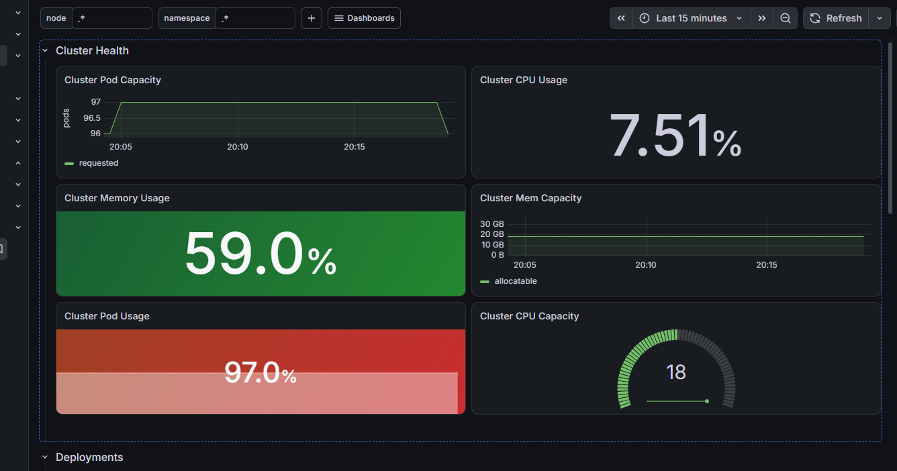

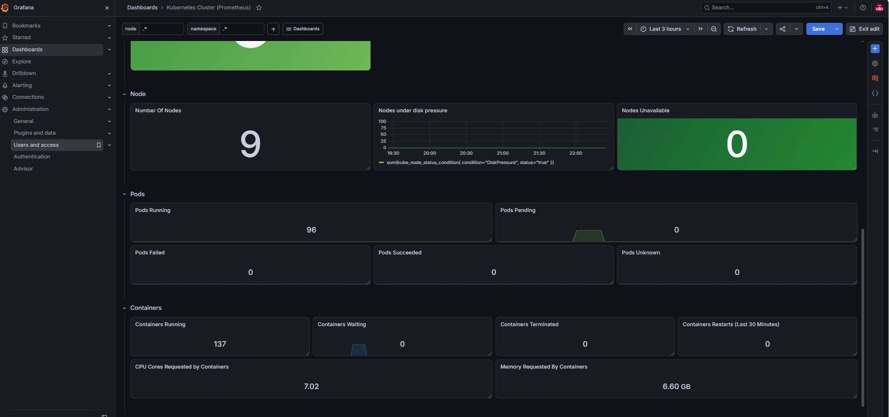

Exported dashboard:
[kubernetes-cluster-6417.json](dashboards/kubernetes-cluster-6417.json)

### CloudWatch Container Insights

CloudWatch Container Insights provides cluster, node, and workload
monitoring for eks-application-dev.

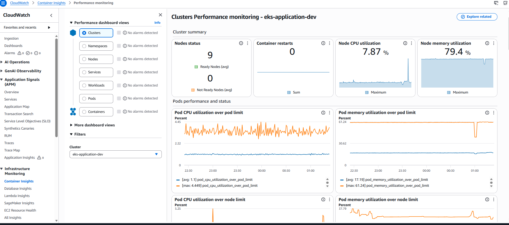

### CloudWatch Logs Insights

CloudWatch Logs Insights was used to query collected container logs.

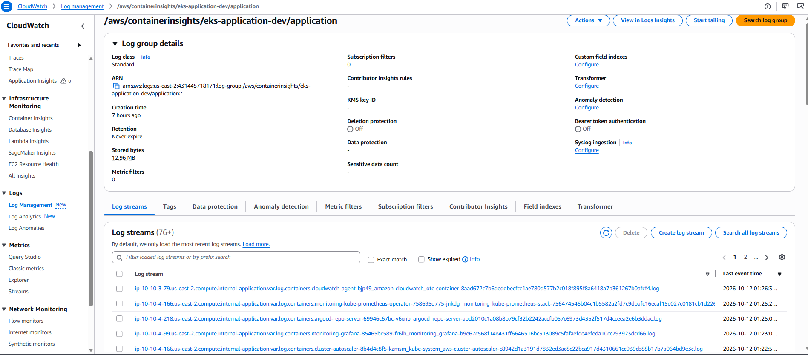
