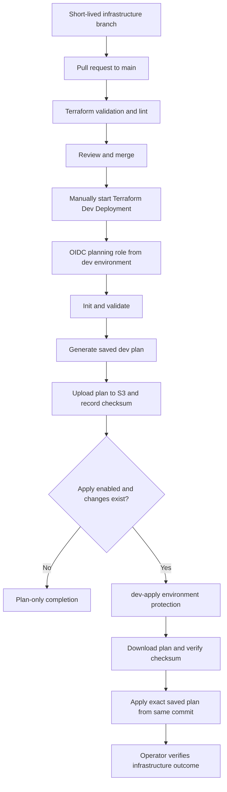

# GitHub branching and Terraform delivery

This guide documents **infrastructure as code only**. Application image pipelines and EC2 container promotion labs are not part of this delivery description. No workflow or Terraform behaviour was changed by the documentation refresh.

## Branching strategy

Use trunk-based development with protected `main` and short-lived branches, for example `feature/private-eks-access`, `fix/rds-security-group` or `docs/mobility-architecture`. Open a focused PR with resource impact, validation evidence and recovery steps. Resolve review conversations and merge only after required checks.

Use environment directories and separate state rather than long-lived environment branches. `main` holds reviewed infrastructure source; it does not imply every environment is running the newest commit.

### Enforced rules versus target review policy

The existing main ruleset requires PRs, resolved review threads, `Terraform Validation` and `Terraform Lint`. It blocks branch deletion and non-fast-forward changes. At the reviewed baseline, the required approving-review count is **zero** and code-owner review is not required.

The target enterprise policy adds independent platform/code-owner review and security review for permission/network changes. That target is not enforced simply by writing this guide. A solo lab cannot demonstrate independent approval of its owner's own PR.

## Existing GitHub workflows

| Workflow | Trigger | Behaviour | Boundary |
|---|---|---|---|
| [terraform-pr-checks.yml](../.github/workflows/terraform-pr-checks.yml) | PR into main or manual | Formatting, validate four environment directories, TFLint, Checkov | Does not create a live AWS plan or apply |
| [Terraform-plan.yaml](../.github/workflows/Terraform-plan.yaml) | Manual, main only | Select dev/test/staging/production; assume environment role; init, validate and plan | Plan only; no saved binary plan/apply job |
| [terraform-dev-deploy.yml](../.github/workflows/terraform-dev-deploy.yml) | Manual, main only | Generate saved dev plan, upload to S3, then conditional apply job in `dev-apply` | Dev only; reviewers are configured outside YAML |

### PR validation details

- Terraform formatting is currently advisory (`continue-on-error: true`).
- Validation initializes with `-backend=false -lockfile=readonly` and validates each environment. This checks configuration, not deployed health or account permissions.
- TFLint runs recursively and is a required main-branch check.
- Checkov currently runs as advisory. A green workflow does not prove no security findings.
- The workflow uses Terraform `1.10.0`; committed lock files pin provider selections.

Promoting formatting/security checks to blocking gates requires reviewing findings and explicit exceptions first. It is a future hardening action, not an implemented control.

## Implemented dev deployment



### Runbook

1. Confirm the correct account, backend, intended environment and permissions. The owner previously destroyed the EKS lab; a plan may therefore propose creating resources again.
2. Open Actions -> **Terraform Dev Deployment** -> Run workflow on `main`.
3. Leave apply disabled for a plan-only run, or enable it when a reviewed deployment is intended. The plan belongs to this run's commit.
4. Inspect resource additions, changes and destructions in the plan output. Do not approve merely because validation passed.
5. For an apply-enabled run, approve the waiting `dev-apply` job if the environment has required reviewers configured and the change is acceptable.
6. The apply job checks out the same commit, downloads the saved plan and checks its SHA-256 checksum before applying it.
7. Review the apply outcome and verify the intended resources. Infrastructure health verification is currently an operator activity, not an automated workflow gate.

When no changes exist, the apply job is skipped. The dev workflow uses the `terraform-dev` concurrency group and does not cancel an in-progress apply. The plan workflow's dev concurrency name also resolves to `terraform-dev`.

### GitHub environment prerequisites

| Environment | Configuration used by IaC |
|---|---|
| dev | `AWS_ROLE_ARN`, `AWS_REGION` for dev plan; the general plan workflow also uses `AWS_ACCOUNT_ID` |
| dev-apply | `AWS_ROLE_ARN`, `AWS_REGION`; configure required reviewers and appropriate branch restrictions |
| test, staging, production | Environment-scoped role, region and account ID for the existing general plan workflow |

OIDC trust must match the repository and relevant GitHub environment. The dev deployment workflow currently fixes the allowed account ID in YAML. The general environment-plan workflow reads it from variables. Role separation depends on the actual role values/policies; two job names alone do not prove least privilege.

Naming `environment: dev-apply` in YAML does not create reviewer protection. Verify GitHub settings. The UI shows secrets/configuration but their values and enforcement are not established by this document.

## State and saved plans

- Each environment has an S3 backend key with encryption and `use_lockfile = true`.
- The current configurations use one backend bucket with separate prefixes; separate keys are not the same as separate AWS accounts.
- Saved dev plans use a path containing run ID, attempt and commit. Protect them as sensitive infrastructure artifacts.
- The checksum verifies the downloaded artifact against the recorded checksum. Bucket access controls and the trusted workflow still matter.
- Do not publish plans or state into Git. Preserve provider lock files.
- Regenerate a stale plan after state or intended configuration changes, then obtain fresh approval.

## Target cross-environment process — not implemented

```text
Reviewed immutable infrastructure commit/module version
  -> dev: plan -> approve/apply -> verify
  -> test: NEW test plan -> review/apply -> verify
  -> staging: NEW staging plan -> approval/apply -> release verification
  -> production: NEW production plan -> release approval -> apply -> verify
```

Promote the code/module version, **not** dev state or its plan. Every environment has a separate configuration, state and plan. Non-production automation may be added after explicit policy decisions; the current infrastructure workflows are manually triggered.

An end-of-month infrastructure release can select a tested commit even while developers continue merging. The future apply workflow must accept and validate an authorized immutable release ref and use it consistently for plan/apply. The current general plan workflow checks out the run revision; the current dev workflow explicitly checks out `github.sha`. Neither is a complete older-candidate promotion implementation.

Use saved-plan review gates independently of any approval before a planning job starts. A protected environment around an entire plan/apply job is not a separate post-plan approval.

## Verification, recovery and support

Check Terraform results, AWS resource status, EKS access from an authorized VPC-connected host, network rules, node readiness and database configuration as appropriate. Record actual checks; a green apply is not proof of end-to-end application readiness.

If apply fails, preserve logs and inspect actual resources and state before another plan. Do not blindly rerun, delete state or restore an old state snapshot as a routine rollback. See [Release strategy](RELEASE.md) for recovery decisions.

## Acceptance gaps

- Independent PR/code-owner reviews and blocking security gates.
- Verify actual environment protections, OIDC policies and backend access.
- Cross-environment saved-plan apply workflows and immutable release-ref validation.
- Automated infrastructure health checks and drift assessment.
- Production RDS availability, backup, retention and deletion-protection settings.
- Terraform coverage for the complete serverless/ServiceNow target architecture.
